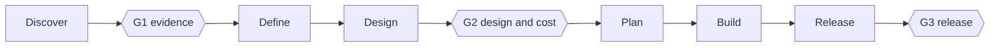

# Startup Swarm

**An AI startup team for Claude Code.** Give it a business or product problem. A hierarchy of specialised, isolated agents runs a startup-style pipeline on it: **evidence → product definition → design → tested, audited code → release package**.

Hooks, not prompts, enforce who can read and write what. Three human gates stop the run from sprinting past a bad premise.

```text
/swarm:run  Build a tool that lets small clinics in India reduce no-shows
```

[Install :material-download:](install.md){ .md-button .md-button--primary }
[Usage guide :material-book-open-variant:](usage.md){ .md-button }
[GitHub :fontawesome-brands-github:](https://github.com/AnimeshShaw/startup-swarm){ .md-button }

!!! warning "Token-intensive by design"
    A full run launches many agents, runs for hours and uses a lot of tokens. There is no cost benchmark yet. Set an account spend limit, use a scratch folder, and start with a small problem. See [Settings](settings.md#budgets-and-limits).

!!! info "Status: v0.1, early"
    65 tests pass and the hooks were probed on a live Claude Code session. Interactive runs, long runs, Windows, Codex and Cursor are not yet field-verified. [Exactly what is and isn't verified](security-model.md#verification-status).

## What you get

<div class="grid cards" markdown>

-   :material-magnify: **Evidence first**

    ---

    A cited market brief, checked by a separate verifier that re-opens every source, then attacked by a red team. Every claim is tagged `FACT`, `ESTIMATE` or `GUESS`.

-   :material-shield-lock: **Enforced isolation**

    ---

    Roles cannot read each other's notes, write outside their scope, edit locked tests, or approve their own gates. Hooks deny it; the prompt is not the safeguard.

-   :material-test-tube: **Test-first build**

    ---

    QA writes tests before code and they are locked by hash. Engineers implement through a CI wrapper. A blind auditor sees only the spec, tests, diff and CI result.

-   :material-gate: **Three human gates**

    ---

    G1 evidence, G2 design and cost, G3 release. Signed with a key outside the project. Only a message you type passes a gate.

-   :material-lightning-bolt: **One-shot or god mode**

    ---

    `/swarm:run` asks at most five batched questions. `/swarm:god` never asks and decides from research, logging every decision and labelling the result `EXPLORATORY`.

-   :material-key-variant: **Secrets stay yours**

    ---

    Agents cannot read `.env`. Live tests inject keys into the test process only and mask them in saved output.

</div>

## The pipeline



| Stage | Output |
|---|---|
| Discover | Market brief, evidence plan, source verification, red team |
| Define | PRD with testable acceptance criteria |
| Design | ADRs, threat model, compliance map, cost model, one-page decision pack |
| Plan | Sprints, tasks, dependency graph |
| Build | Locked tests, implementation, blind audit, security audit |
| Release | Deploy configuration (never executed), release report |

## Quick start

=== "Claude Code"

    ```bash
    claude plugin marketplace add AnimeshShaw/startup-swarm
    claude plugin install swarm@startup-swarm
    ```

    Then, in a **scratch project folder**:

    ```text
    /swarm:run Small physiotherapy clinics lose 20% of bookings to no-shows. Build a tool that fixes this.
    ```

=== "Inside a session"

    ```text
    /plugin marketplace add AnimeshShaw/startup-swarm
    /plugin install swarm@startup-swarm
    ```

=== "Try without installing"

    ```bash
    git clone https://github.com/AnimeshShaw/startup-swarm
    claude --plugin-dir ./startup-swarm/adapters/claude
    ```

Requires Python 3.9+ on PATH. Standard library only, no other dependencies.

## Where it works

| Host | Experience | Status |
|---|---|---|
| **Claude Code** | Full: isolated subagents, enforcement hooks, one-shot commands | Hooks live-probed; interactive runs in progress |
| Codex | Sequential, skills only, isolation by convention | Untested on a live host |
| Cursor | Sequential, skills only, isolation by convention | Untested on a live host |

Why the difference is explained in [Install](install.md).

## What it is not

It cannot interview customers, run ads or take payment. Its market numbers are desk research, so treat them as hypotheses to test. Output is a very well-read first draft, not a verdict. Read the [usage guide](usage.md#5-what-to-use-it-for) before pointing it at anything important.
